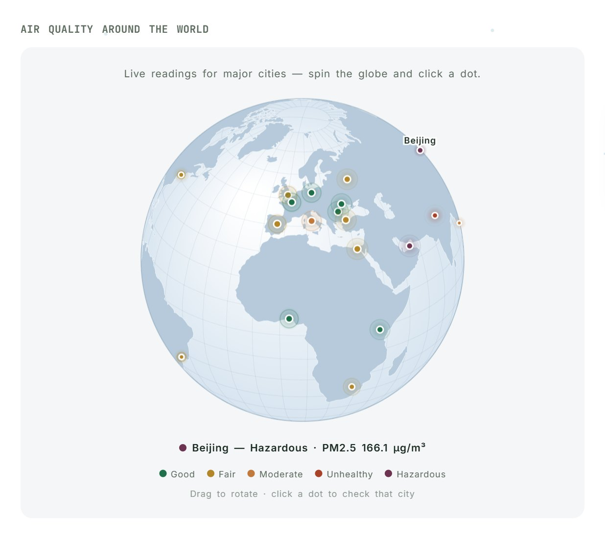
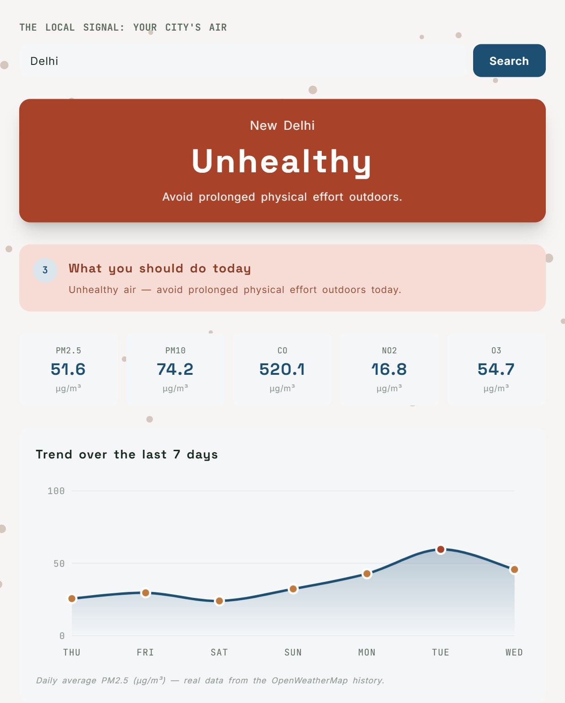
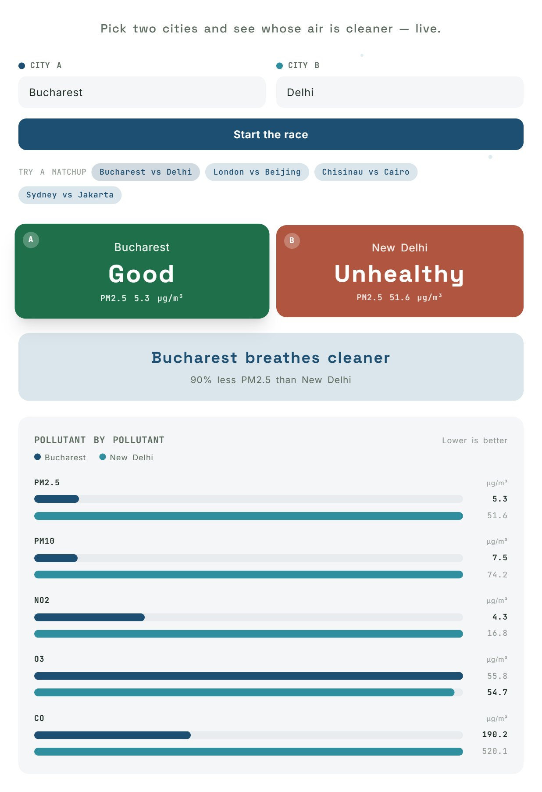
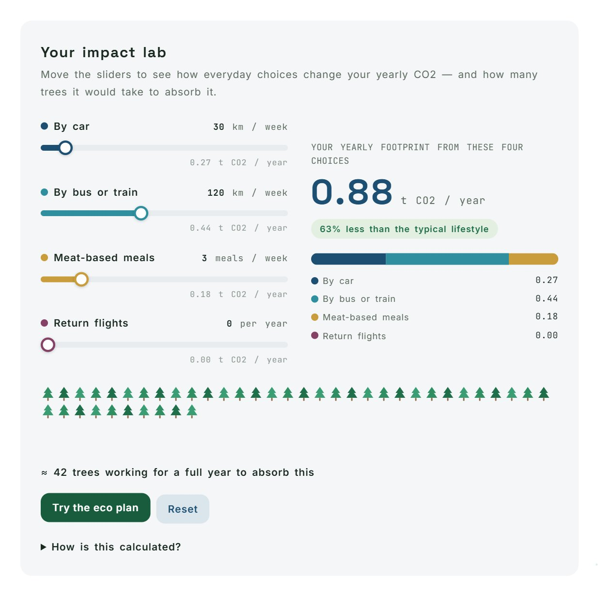
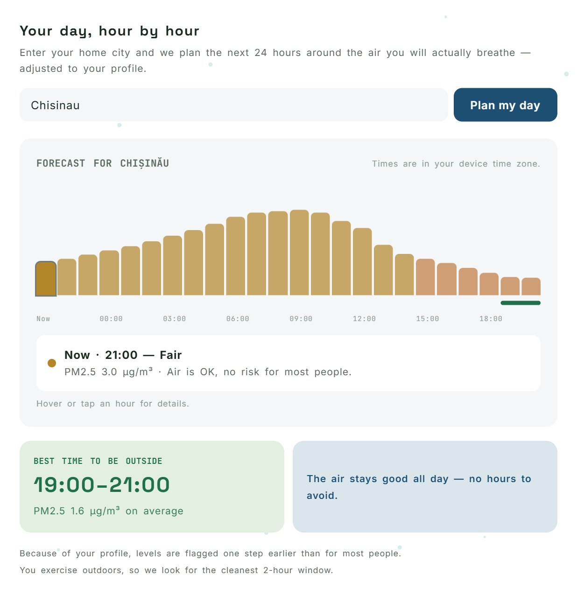
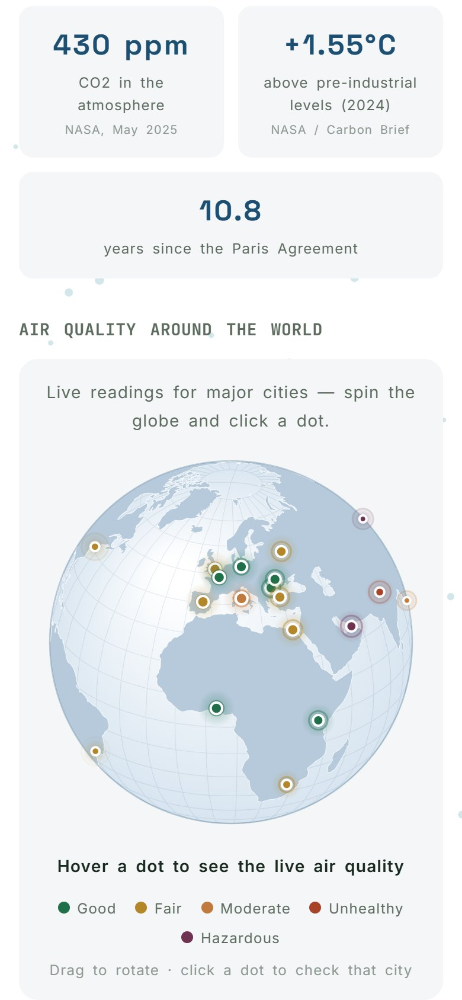

# 🌍 ClimaWatch

**Climate change is global and abstract. The air pollution in your own city is a local, concrete signal of the very same causes.** ClimaWatch connects the two — real climate data, live air quality for any city, and recommendations personalized to you.

Project submitted to Infomatrix, category **Software Development** (Project Contest).

### 🔴 [Try the live app → clima-watch.vercel.app](https://clima-watch.vercel.app)

---

## 1. Project Description

### The problem

- **+1.55°C** above pre-industrial levels — 2024, the hottest year ever recorded ([NASA / Carbon Brief](https://www.carbonbrief.org/state-of-the-climate-2025-in-top-three-hottest-years-on-record-as-ocean-heat-surges/))
- **430 ppm** of CO2 in the atmosphere — the highest level in over 3 million years ([NASA](https://science.nasa.gov/earth/explore/earth-indicators/carbon-dioxide/))
- **+11 cm** sea level rise since 1993 — the rate has nearly doubled since 2012 ([NASA / NOAA](https://climate.nasa.gov/vital-signs/sea-level/))

The problem isn't a lack of data — sensors and public APIs already exist. It's that this data is hard for an average person to interpret, and climate effects are felt slowly, globally, and abstractly — hard to connect to everyday life.

### The solution

ClimaWatch bridges the **global** and the **local**:

1. **Live global climate context** — atmospheric CO2, global warming, years since the Paris Agreement (computed dynamically).
2. **A concrete, local signal** — check real-time air quality for any city, via an external API.
3. **A personal profile** — tell the app if you have asthma, a young child, exercise outdoors, or want carbon-footprint tips, and recommendations adapt to you.
4. **An action recommendation, not just a status** — "avoid running outside today," not just "Moderate air quality."
5. **Proactive alerts** — a browser notification when air quality turns unhealthy for your profile.
6. **An interactive historical chart** — CO2 emissions by country, from 1750 to today (Our World in Data).
7. **Links to real organizations** — UNFCCC, Climate & Clean Air Coalition.
8. **A live 3D-style globe** — 26 world cities as glowing dots colored by their current air quality; drag to rotate, hover for details, click a city to open its full report. Drawn from scratch on a `<canvas>` with an orthographic map projection.
9. **A background that breathes with the air** — a particle field whose density, speed, color and breathing rhythm follow the air quality of the last city checked: calm and clear for clean air, dense, murky and labored for polluted air.
10. **Real 7-day history** — hourly measurements aggregated into daily PM2.5 averages and drawn as an animated, hoverable chart (no mock data). Each day also carries a continuous US EPA AQI (0–500) computed from the pollutant concentrations, not an average of OpenWeatherMap's coarse 1–5 categories.
11. **City race** — compare two cities head to head, pollutant by pollutant, with animated bars and a verdict.
12. **Impact lab** — four sliders (car km, bus/train km, meat meals, flights) turn everyday choices into a yearly CO2 figure with a live breakdown bar and a small forest of trees sized to offset it; one click loads an "eco plan" to compare against a typical lifestyle.
13. **Your day, hour by hour** — enter a home city (remembered on the device) and the real 24-hour air-quality forecast is drawn as an hourly strip, colored for your profile (asthma or a young child shift every hour one level stricter), with the best time to be outside and the hours to avoid picked out. Hours are shown in the **searched city's own time zone**, not the viewer's.
14. **A tested research question** — *can a small local model correct a global air-quality grid?* A pre-registered benchmark of four methods on 576 city-days from Chișinău and București, a cost model, and a bounded health-economics estimate, all shown on the **Research** page and documented in [`research/`](research/) and [`docs/moldsef/`](docs/moldsef/). See [section 8](#8-research-benchmark--economic-analysis-moldsef-track).

Available in **English, Romanian, and Russian**.

### Screenshots

All screenshots are taken from the live app ([clima-watch.vercel.app](https://clima-watch.vercel.app)), with real data from the day they were captured.



*Live world globe — each dot is a city colored by its current air quality; hover for details, click to open its full report.*



*A city's live report — status, an action recommendation, five pollutants and a real 7-day PM2.5 history. The particles in the background are denser and murkier because the air is unhealthy.*



*City race — two cities head to head, pollutant by pollutant, with a verdict.*



*Impact lab — everyday choices turned into yearly CO2, compared with a typical lifestyle, and shown as the trees needed to offset it.*



*Your day, hour by hour — the real 24-hour forecast for a home city, colored for the user's profile, with the best time to be outside.*



*The same app on a phone — the layout adapts, and the globe supports touch.*

---

## 2. People Involved

| Role | Name |
|---|---|
| Student developer | Mihai Chircu |
| Supervisor | Azamat Jauysh |

Team size: 1 student (solo entry), within the category's 1–2 student limit.

---

## 3. Early-Stage Plan, Design Decisions & Timeline

Before writing code, the project started from one framing question: *how do you make an abstract, global problem (climate change) feel personally relevant to one person, in one city, today?* That question shaped three early decisions that drove the rest of the design:

1. **Pair a global stat strip with a local, searchable signal** — instead of a wall of climate statistics, the homepage opens with a short global context strip, then immediately lets the user check their own city.
2. **Personalize instead of just display** — a flat AQI number means little to most people. A short profile (asthma, young child, outdoor sport, carbon-footprint interest) was planned from the start so the same air-quality reading could produce a different, actionable recommendation for each user.
3. **Never expose the third-party API key in the browser** — since the app would call a paid-tier-capable weather API, the architecture was split into a frontend and a small backend proxy from the first design pass, specifically so the API key would never ship to the client (see [Architecture](#4-architecture) and [Problems Faced](#6-problems-faced--how-they-were-solved) below).

From there the feature set grew iteratively: global context → city search and AQI display → profile-based recommendations → proactive browser alerts → historical emissions chart → multi-language support (RO/EN/RU) → a world globe, a data-driven particle background, real 7-day history and a two-city comparison.

### Development timeline

This timeline follows the project's Git history (every entry matches commits in the repository).

| Date | What happened |
|---|---|
| **12 Sep 2026** | **First working version.** React + TypeScript frontend with a serverless backend that keeps the API key secret. Live air quality for any city, profile-based recommendations, browser alerts, global climate context, an interactive CO2 chart, and RO/EN/RU translations, with tests. Deployed to Vercel and linked from the README. |
| **6 Oct 2026** | **Aligned with the Infomatrix rules.** Read the official regulations and the Software Development rubric. Rewrote the documentation in English with the required sections, added the MIT license and the Responsible AI disclosure, made English the default language, translated route names and code comments, fixed a hard-coded Romanian caption that showed in every language, and fixed a 404 on direct links to inner pages. |
| **6 Oct 2026** | **Visual redesign, in several iterations.** From a dark neon look to a calmer light theme, then adjustments to text spacing, the accent color (green → blue) and the typography (several fonts tried before settling on Space Grotesk and Inter). |
| **14 Oct 2026** | **New interactive features.** White, borderless interface; live world globe; particle background driven by air quality; real 7-day history replacing the mock chart; two-city comparison; impact lab; and the hour-by-hour planner. Three new backend endpoints with caching, and the test suite grew to 72 tests. README updated with screenshots. |
| **5 Nov 2026** | **Research upgrade after the supervisor's evaluation.** Continuous EPA AQI for the history, city time zone in the planner, a pre-registered PM2.5 calibration benchmark (four methods, 576 test windows), a cost and health-economics model with a Research page, CDN cache changes, the MoldSEF abstract, visual annex and lab logbook. Tests grew from 72 to 145. |

Official competition dates (from [infomatrix.ro](https://www.infomatrix.ro), to be re-checked on the portal): submission deadline **15 March 2027**, finalists announced **20 March 2027**, World Finals in Bucharest **27–31 May 2027**.

---

## 4. Architecture

```
Browser (React)                    Server (serverless functions)
┌─────────────────────┐            ┌────────────────────────────────┐
│  utils/airApi.ts     │  fetch     │  api/air-quality.ts   (a city) │
│  /api/air-quality    │ ─────────▶ │  api/air-history.ts   (7 days) │
│  /api/air-history    │            │  api/air-forecast.ts  (24 h)   │
│  /api/air-forecast   │            │  api/cities-air.ts    (globe)  │
│  /api/cities-air     │            │            │                   │
└─────────────────────┘            │            ▼                   │
                                    │  api/_lib/  getAirQuality,     │
                                    │  getAirHistory, getAirForecast,│
                                    │  getCitiesAir, geocode (shared)│
                                    └──────────────┼─────────────────┘
                                                   │ appid=<hidden key>
                                                   ▼
                                        OpenWeatherMap API
```

- **The API key never reaches the browser** — it lives only in `WEATHER_API_KEY`, a server-side environment variable, without the `VITE_` prefix that would expose it to the client bundle.
- In **production** (Vercel), each `api/*.ts` file runs as a real serverless function.
- In **local development**, `vite-plugins/localApi.ts` emulates the exact same endpoints through Vite's own dev server — no account, no external CLI, no cost.
- All four data endpoints send `Cache-Control: s-maxage` headers (10 minutes for current readings and the globe, 1 hour for history and forecast, which have hourly resolution), so Vercel's CDN shares upstream calls between visitors and the app stays inside the free API quota. The effect is quantified in [section 8](#8-research-benchmark--economic-analysis-moldsef-track) and a test keeps the cost model in step with the real cache lifetimes.
- The forecast endpoint also resolves the city's IANA time zone from [Open-Meteo](https://open-meteo.com/) (no key, 3 s timeout, falls back to the viewer's zone), so hours are labeled in local time.

---

## 5. Software & Hardware Specifications

| | |
|---|---|
| Frontend | React 19, TypeScript, Vite, Tailwind CSS v4, React Router |
| Backend | Serverless functions (Node.js, Vercel function format) |
| Translations | Custom React context (RO/EN/RU), no external library |
| Live data | [OpenWeatherMap](https://openweathermap.org/) (geocoding, current air quality, hourly history and forecast); [Open-Meteo](https://open-meteo.com/) (time zone) |
| Research | Node 24 running TypeScript natively; ridge regression and gradient-boosted trees written from scratch (no ML library); ground truth from [Sensor.Community](https://archive.sensor.community/); weather from ERA5 via Open-Meteo |
| Globe | HTML canvas + [d3-geo](https://github.com/d3/d3-geo) (orthographic projection) + [world-atlas](https://github.com/topojson/world-atlas) / [topojson-client](https://github.com/topojson/topojson-client) (Natural Earth coastlines); lazy-loaded as its own chunk |
| Charts and animation | Hand-written SVG (smooth Bézier history chart) and canvas (particle field) — no charting library |
| CO2 chart | [Our World in Data](https://ourworldindata.org/) (live embed) |
| Video | [TED](https://www.ted.com/) — Katharine Hayhoe |
| Testing | Vitest (145 tests) |
| Hardware | None — ClimaWatch is a web application; it runs in any modern browser on any device with an internet connection (desktop, laptop, tablet, or phone). No dedicated hardware was built or required. |

### Project structure

```
src/
  components/     Reusable UI (cards, AirGlobe, BreathingBackground, HistoryChart, embeds)
  pages/          Problem, Solution, Live check, Compare, My profile
  hooks/          useAirQuality, useCompare, useProfile
  context/        AirMood (shares the latest air quality with the background)
  i18n/           RO/EN/RU translations + language context
  utils/          Recommendations, API client, mood, comparison and chart-path logic
  constants/      AQI thresholds and colors
api/
  air-quality.ts, air-history.ts, air-forecast.ts, cities-air.ts   Serverless functions (deployable)
  _lib/                                           Shared backend logic + tests (incl. aqiIndex.ts, timezone.ts)
vite-plugins/
  localApi.ts     Emulates the backend in local development
research/
  PREREGISTRATION.md   Hypotheses and decision rule, written before the models were run
  pipeline/            Data download and hourly dataset builder
  ml/                  Ridge, gradient-boosted trees, metrics, blocked CV, bootstrap (+ tests)
  benchmark.ts         The experiment; writes results/benchmark.json
  data/                Hourly datasets and sensor lists (raw downloads are git-ignored)
docs/
  moldsef/             Abstract (2 pages), visual annex (1 page), lab logbook
```

---

## 6. Problems Faced & How They Were Solved

- **Risk of leaking the API key to the client.** A client-side `fetch` straight to OpenWeatherMap would ship the API key in every browser request, visible to anyone who opens dev tools. *Solution:* the app never calls the third-party API directly from the browser — it calls a same-origin `/api/air-quality` endpoint, and only the server-side code holds the key. This is covered by an automated test (`getAirQuality.test.ts`) that asserts the key never appears anywhere in the response body.
- **No backend during local development.** Serverless functions only run once deployed, which would make local development slow and dependent on a Vercel account. *Solution:* `vite-plugins/localApi.ts` emulates the same `/api/air-quality` route inside Vite's own dev server, so the frontend and backend logic can be developed and tested together with a single `npm run dev`, no deployment needed.
- **Unreliable third-party input.** The air-quality API can be called with a missing city, a blank city, a city that doesn't exist, or without a configured key. *Solution:* each case is handled explicitly and covered by tests — a missing/blank city returns `400`, a missing server key returns `500`, and a city with no geocoding match returns `404`, instead of the app crashing or showing a misleading result.
- **One AQI number means different things to different people.** A "Moderate" air-quality reading isn't equally relevant to everyone. *Solution:* a lightweight local profile (asthma, young child, outdoor sport, carbon-footprint interest) is combined with the live AQI to produce a specific recommendation, tested against every profile × air-quality combination in `recommendations.test.ts`.
- **A history chart built on made-up numbers.** The first version of the 7-day chart used random values and said so in a footnote — honest, but not real functionality. *Solution:* `api/_lib/getAirHistory.ts` fetches OpenWeatherMap's hourly history for the city's exact coordinates, groups it into UTC days and averages PM2.5, and builds a continuous US EPA AQI per day from the pollutant concentrations (`aggregateDaily` and `aqiIndex.ts`, unit-tested). The first version averaged OpenWeatherMap's 1–5 integers, which hides almost all variation inside a category. The chart itself is hand-written SVG: a Catmull-Rom curve converted to Bézier segments, with control points clamped so the curve can never dip below the axis (`utils/chartPath.ts`, unit-tested).
- **Loading 26 cities for the globe without burning the API quota.** One globe load means 26 upstream calls, against a free limit of 60 per minute shared by every visitor. *Solution:* a fixed city list on the server, `Promise.allSettled` so one failing city is skipped instead of breaking the batch, and a `Cache-Control: s-maxage=600` header so Vercel's CDN serves the same result to everyone for 10 minutes.
- **A heavy 3D library for a single widget.** WebGL globe libraries add hundreds of kilobytes. *Solution:* the globe is drawn on a 2D canvas with d3-geo's orthographic projection and real Natural Earth coastlines, with its own drag, inertia, hit-testing and fly-to-city animation, and it is lazy-loaded as a separate ~35 kB (gzipped) chunk, so the rest of the app is unaffected.
- **Rotating dots are hard to click, and a canvas can steal page scrolling on phones.** *Solution:* auto-rotation pauses while the pointer is over the globe or for a moment after a drag, and the canvas uses `touch-action: pan-y` so vertical swipes still scroll the page while horizontal drags rotate the globe.
- **A calculator that must not invent numbers.** An "impact" slider is only worth showing if its figures are defensible. *Solution:* every factor lives in one tested module (`utils/impact.ts`) and is listed, with its source, in a "How is this calculated?" note inside the UI — 0.17 kg CO2 per car-km and 0.15 per flight-km (UK government conversion factors), 1.13 kg more per meat meal than a vegetarian one (derived from Scarborough et al., 2014), about 21 kg absorbed per tree per year. The "typical lifestyle" it compares against is stated openly, and the page says these are estimates, not a carbon audit.
- **Making a forecast personal, not just visible.** One AQI level means different things to different people. *Solution:* `utils/planner.ts` shifts every hour one level stricter for asthma or a young child, finds the cleanest window with a sliding average (1 hour normally, 2 hours if the user exercises outdoors), and only flags "hours to avoid" when the adjusted level actually reaches Moderate or worse; all of it is unit-tested. Hours are labeled in the searched city's own time zone (`api/_lib/timezone.ts`, `utils/time.ts`), which was a known limit of the first version.
- **A claim about caching that the code did not support.** The first version cached only some endpoints. *Solution:* `/api/air-quality` now has a 10-minute CDN cache, history and forecast went from 15 minutes to 1 hour (the upstream data is hourly), typed city names are normalized before they become cache keys, and `cacheTtl.test.ts` fails if the cost model and the endpoints ever disagree.
- **Free data that doesn't contain the answer.** The benchmark needed ground-truth PM2.5 from the same cities. The OpenAQ API needs a key and its public archive has no location metadata; the EEA service failed. *Solution:* the open Sensor.Community archive (low-cost sensors, available from 2026-01-01), with a plausibility filter, the median across sensors, and a humidity sensitivity check; the limits are written down in the pre-registration, not hidden.
- **A result that missed its target.** The hypotheses were fixed before the run; one was partially supported and one was not. *Solution:* report them with the same decision rule, add robustness checks (forward-chaining, the other city, dry hours, seasons), and let the data change the recommendation (a ridge model instead of trees) rather than the thresholds.
- **Ambiguous city names and out-of-order responses.** "Lagos" can match more than one place, and a slow answer to an older search could overwrite a newer one. *Solution:* globe clicks search by `City,CountryCode` (e.g. `Lagos,NG`), and each search carries a request counter so stale responses are ignored.
- **Decorative animation that should not hurt users.** *Solution:* the particle background is capped at 240 particles, limits canvas pixel density, and its parameters ease toward each new air-quality state instead of jumping; both it and the globe respect the browser's "reduce motion" setting.
- **Reaching an international-style audience in one codebase.** The project needed to work for Romanian, English, and Russian speakers without pulling in a heavy i18n library. *Solution:* a small custom React context (`i18n/LanguageContext.tsx`) holds the active language and a typed translation table, with the saved preference persisted in `localStorage` and English used by default on a first visit.

---

## 7. Responsible AI Usage

AI tools were used during development, in line with the category's rules on citing AI assistance.

- **Tool used:** [Claude Code](https://claude.com/claude-code) (Anthropic), an AI coding assistant built on Claude models, used as a pair-programming tool throughout development.
- **How it was used:** scaffolding the project structure, writing and refactoring frontend/backend TypeScript code, generating the automated test suite, and drafting documentation (including this README) from directions and requirements given by the student.
- **Human oversight:** every piece of generated code was reviewed, run, and tested before being kept in the project. Product decisions — what the app should do, which problem it solves, how recommendations should behave, what the architecture should protect against (see [Problems Faced](#6-problems-faced--how-they-were-solved)) — were directed by the student, not the AI.
- **Research and economics:** Claude Code wrote the data pipeline, the models and the cost model. The hypotheses, thresholds and decision rule were written down before the run; verdicts are computed by code and reported as they came out. The bibliographic details of every cited paper were verified in PubMed/Crossref; the effect sizes and costs come from the studies' abstracts as found by web search, so the student must confirm each one in the full text (see the logbook). The one input with no source — the baseline rate of emergency asthma episodes — is labeled as an assumption. The student's own checks are listed in [`docs/moldsef/logbook.md`](docs/moldsef/logbook.md).
- **What was not AI-generated:** the live third-party data (OpenWeatherMap, Our World in Data), the climate statistics and their sources, and the TED video are all real external sources, linked and credited in [Sources](#sources) below — none of it is AI-generated content.

No AI-generated text, image, or code in this project is presented as original human work without this disclosure.

## 8. Research, Benchmark & Economic Analysis (MoldSEF track)

Everything below is produced by code in this repository (`research/`, `src/utils/economics.ts`) and shown live on the **Research** page of the app.

### Hypothesis (pre-registered)

[`research/PREREGISTRATION.md`](research/PREREGISTRATION.md) was written **before** any model was evaluated. Free global air-quality grids (OpenWeatherMap) are coarse; the question is whether a small model that uses only forecast-time inputs can correct their PM2.5 toward what local sensors measure.

- **H1.** Gradient-boosted trees reduce hourly PM2.5 RMSE by **≥ 22%** against the raw grid over N ≥ 100 held-out 24-hour windows.
- **H2.** The same model reduces the miss rate of unhealthy-air alerts (daily mean ≥ 15 µg/m³, the WHO 2021 guideline) by **≥ 18%**.
- **Decision rule:** *supported* = point estimate ≥ target **and** a 95% day-block bootstrap interval that excludes 0; *partially supported* = interval excludes 0 but the estimate is below target; otherwise *not supported*.

### Data and method

| | |
|---|---|
| Cities, period | Chișinău and București, 1 Jan–31 Oct 2026, hourly (6,912 rows each; 16 days are missing from OpenWeatherMap's own history in both cities) |
| Ground truth | Hourly median of [Sensor.Community](https://archive.sensor.community/) low-cost particle sensors within 12 km of the centre (5 and 10 sensors), with a plausibility filter |
| Baseline input | OpenWeatherMap `air_pollution/history` |
| Features | 20: grid pollutants, ERA5 weather (temperature, humidity, wind, pressure, precipitation, boundary-layer height), hour, weekday. No sensor value is an input |
| Models | raw grid · scale + offset · ridge regression · gradient-boosted trees (250 trees, depth 4, written from scratch, hyper-parameters fixed in advance) |
| Validation | Blocked 6-fold cross-validation per city with 2-day gaps; each of **576 city-days (13,791 hours)** is tested exactly once; 2,000-resample day-block bootstrap |

### Results

| Method | RMSE (µg/m³) | Change | MAE | r | Unhealthy days missed (of 49) | F1 | µs / prediction |
|---|---|---|---|---|---|---|---|
| Raw OpenWeatherMap | 6.28 | — | 3.97 | 0.49 | 31 (63%) | 0.39 | 0.015 |
| Scale + offset | 5.52 | −12.0% | 3.76 | 0.49 | 36 (74%) | 0.37 | 0.029 |
| Ridge regression | 5.00 | −20.3% | 3.24 | 0.61 | 33 (67%) | 0.42 | 0.035 |
| Gradient-boosted trees | 4.99 | −20.5% | 3.15 | 0.65 | 23 (47%) | 0.52 | 10.7 |

- **H1 is partially supported:** −20.5% (95% interval 14.5–26.4%), 1.5 points short of the 22% target.
- **H2 is not supported:** the miss rate fell by 25.8% (63% → 47%), above the 18% target, but with only 49 unhealthy days the interval is 0–48.6% and does not exclude zero.
- The gain holds in the heating season (−24.2%) and on dry hours only (−27.2%, which addresses the humidity bias of low-cost sensors) and differs by city (Chișinău −39%, București −11%).
- **Trees did not beat a linear model** (−20.5% vs −20.3%), and were less stable on months they had not seen (−2.7% vs −16.2%). A per-city ridge model is the better deployment candidate; it is about 300× cheaper to run.
- Latency was measured on an Intel Core i7-9700K with Node 24; training takes about 0.6 s per fold.

**Limits, stated in advance:** OpenWeatherMap keeps no forecast archive, so its value for the target hour stands in for the forecast (*perfect-prognosis*): this tests the calibration step, not forecast skill. The sensors are low-cost, not regulatory stations. Two cities, ten months, and few unhealthy days.

### Economic and social impact

| | Dedicated display monitors | ClimaWatch |
|---|---|---|
| Hardware for 100 sites | €31,900 (IQAir AirVisual Pro, €319 list price); US$28,900 (PurpleAir Flex); US$20,900 (PurpleAir Touch) | €0 (any browser) |
| Hosting and API per month | — | €0 inside the free tiers |
| Upstream API calls per month, 10,000 users × 4 visits | — | 1,200,000 without a cache (over the 1,000,000 free quota) → **238,952** with the CDN cache (−80.1%; −92.6% at 100,000 users) |
| Users per month inside the free tier | — | 8,333 without a cache → **119,706** with it |
| Avoided asthma emergency episodes per 10,000 users a year | — | 0.001 – 0.63 (base 0.017) |
| Health-system saving per 10,000 users a year | — | €0.22 – €655 (base €6) |

Those monitors measure one spot directly, which ClimaWatch does not; the comparison is the cost of putting an air-quality advisory in front of people. The health figures are an order-of-magnitude model (attributable fraction 1 − RR^(−Δ/10)) built from published relative risks, published behavioural responses to air-quality alerts, published emergency-visit costs and the exposure gain measured in our own data; its baseline episode rate is an **assumption**. Honest reading: the modelled health savings are small at this scale; the case for ClimaWatch rests on near-zero cost per user. The ">95% fewer upstream calls" that is sometimes quoted for edge caching is not what the model gives for a long-tail city audience at 10,000 users (80%); it is reported as computed.

### Where everything is

| File | What it is |
|---|---|
| [`research/PREREGISTRATION.md`](research/PREREGISTRATION.md) | Hypotheses, decision rule and design, fixed before the run |
| [`research/results/benchmark.json`](research/results/benchmark.json) | Every number above, plus robustness checks, feature importance and latency |
| [`docs/moldsef/abstract.pdf`](docs/moldsef/abstract.pdf) | The 2-page abstract (Times New Roman 12 pt); `abstract.html` is the source |
| [`docs/moldsef/visual-annex.pdf`](docs/moldsef/visual-annex.pdf) | The 1-page visual annex, generated by `research/makeAnnex.ts` |
| [`docs/moldsef/logbook.md`](docs/moldsef/logbook.md) | Dated laboratory logbook: reconstructed history, experiments, failure cases, human-verification checklist |

```bash
node research/pipeline/fetchDataset.ts   # downloads ~190 MB (cached, git-ignored); needs WEATHER_API_KEY in .env
node research/benchmark.ts               # about 20 s, writes research/results/benchmark.json
```

The committed hourly datasets in `research/data/` let the benchmark be re-run offline. A test checks that the numbers quoted in the abstract equal the numbers in `benchmark.json`.

---

## Running locally

```bash
npm install
npm run dev
```

You need a `.env` file at the project root:

```
WEATHER_API_KEY=your_openweathermap.org_key
```

(free key, no credit card required)

## Testing

```bash
npm test
```

145 tests cover the recommendation logic (every profile × air-quality combination); the four backend modules (`getAirQuality`, `getAirHistory`, `getAirForecast`, `getCitiesAir`: missing or invalid input, missing API key, city not found, partial upstream failures, valid responses, and that the API key never leaks into a response); and the pure logic behind the newer features (daily history aggregation, chart path generation, particle "mood" per air-quality level, the two-city verdict, the CO2 calculator, and the day planner's profile adjustment and best/worst window search), and the newer research work: the EPA AQI computation, city time-zone formatting, the ridge and gradient-boosted-tree implementations, the blocked cross-validation and bootstrap, the cost and health model (including a test that it uses the real cache lifetimes), and a check that the abstract quotes the real benchmark numbers.

## Deployment

The `api/*.ts` structure is automatically recognized by [Vercel](https://vercel.com) — connect the repo, add `WEATHER_API_KEY` as an environment variable in the dashboard, done. The Hobby tier is free, no credit card required.

## Sources

NASA (climate.nasa.gov), NOAA (noaa.gov), IPCC (ipcc.ch), Carbon Brief, Our World in Data (ourworldindata.org), IQAir World Air Quality Report 2025, EPA (epa.gov), AirNow.gov, TED, UNFCCC (unfccc.int), Climate & Clean Air Coalition (ccacoalition.org), OpenWeatherMap (openweathermap.org), Natural Earth coastlines (naturalearthdata.com, via the world-atlas package), US EPA, Technical Assistance Document for the Reporting of Daily Air Quality (AQI breakpoints, 2024 revision); WHO global air quality guidelines 2021; Sensor.Community open archive (archive.sensor.community); Open-Meteo (ERA5 archive and time zones); Lim et al. 2016, J Prev Med Public Health 49:205–219; Fan et al. 2016, Environ Sci Pollut Res 23:843–850; Saberian, Heyes & Rivers 2017, Resour Energy Econ 49:165–185; Ward & Beatty, Environ Resour Econ 65:487–511; Pugliese et al. 2020, Eur Rev Med Pharmacol Sci 24:11729–11739; Bavbek, Mungan & Türktaş 2011, Respir Med 105:541–548; UK Government GHG conversion factors for company reporting (gov.uk), Scarborough et al. (2014), "Dietary greenhouse gas emissions of meat-eaters, fish-eaters, vegetarians and vegans in the UK", Climatic Change 125.

## License

[MIT](LICENSE) — open source, per Infomatrix competition rules.
